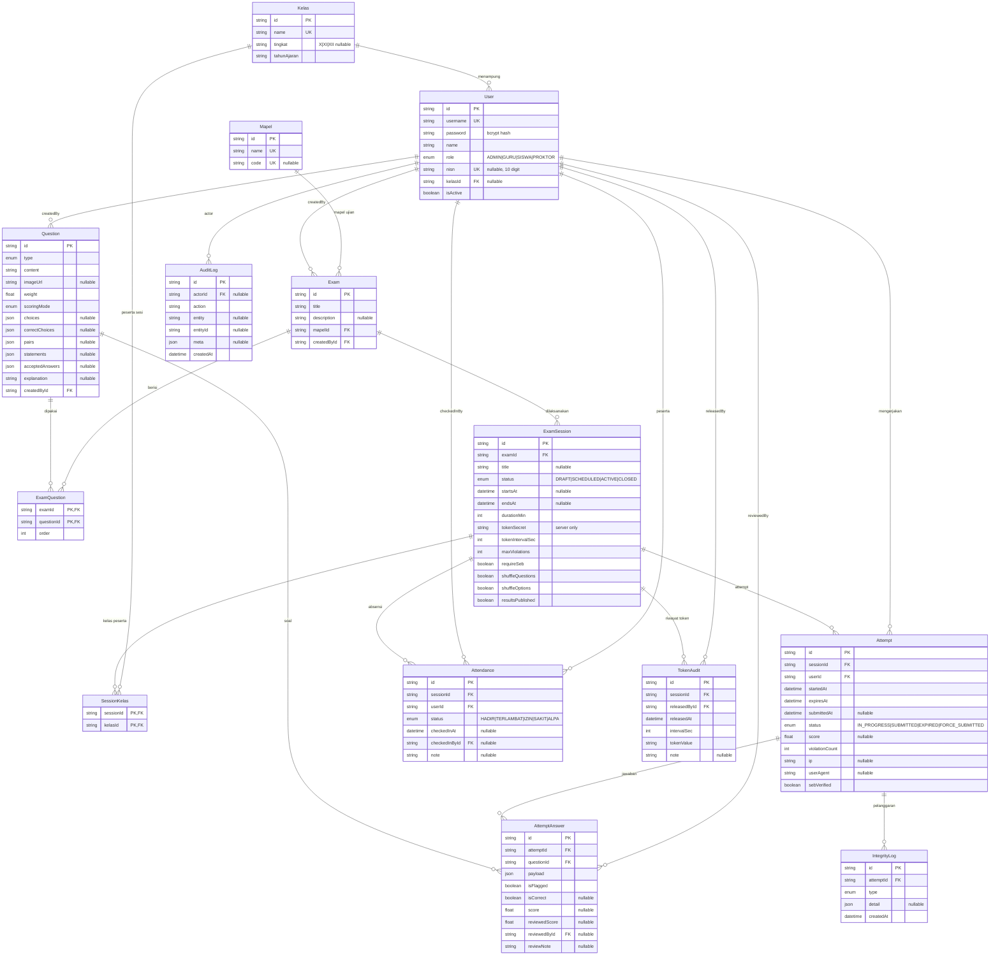

# ERD & Model Data — CBT SMAN 1 Gorontalo

| Field | Nilai |
| --- | --- |
| Versi | 1.1 |
| Tanggal | 15 November 2026 |
| Sumber kebenaran | `apps/api/prisma/schema.prisma` |
| Database | PostgreSQL 16 |
| ORM | Prisma 5.22 |
| Dokumen terkait | [PRD](./PRD.md) · [API](./API.md) |

Dokumen ini menjelaskan struktur data, relasi, constraint, dan bentuk kolom JSON. Jika terjadi perbedaan, **schema Prisma adalah sumber kebenaran**; perbarui dokumen ini saat migrasi.

> **Catatan drift (Nov 2026):** skema kini multi-sekolah — ada model `School` (SMAN 1 & SMAN 8) dan kolom `schoolId` (+ tenant filter) di SEMUA tabel bisnis. Model lain yang belum digambar di sini: `ExamEnrollment` (enrol peserta per ujian), `Kelas.ruang` (ruang ujian), `ExamSession.hariPelaksanaan` & `visibleToSiswa`, `Attempt.lockedAt`, `User.initialPassword` (terenkripsi at-rest), `Mapel.kkm`, `AuditLog.schoolId`, `GlobalConfig(schoolId, key)`. Unik global kini unik **per sekolah** (`(schoolId, name)` dsb).

---

## 1. Cara memelihara

```bash
npm run prisma:generate     # generate client
npm run prisma:migrate      # migrasi dev
npm run prisma:studio       # inspeksi data visual
```

Aturan umum:

- Semua ID memakai `cuid()` (kecuali tabel relasi komposit).
- Waktu disimpan `timestamp` (UTC); API mengirim ISO-8601.
- Nama unik memakai `@unique`; relasi banyak-ke-banyak memakai tabel pivot berkomposit.
- Penghapusan induk memakai `onDelete: Cascade` pada data turunan kecuali dinyatakan lain.

---

## 2. Diagram ERD



> `GlobalConfig` berdiri sendiri (key–value, tanpa relasi) dan tidak digambar agar diagram tetap terbaca.

---

## 3. Entitas & tanggung jawab

| Entitas | Ringkasan | Kunci/constraint penting |
| --- | --- | --- |
| `User` | Akun semua role; siswa terhubung ke kelas | `username` unik; `nisn` unik nullable; password bcrypt |
| `Kelas` | Rombel + tahun ajaran | `name` unik; `tahunAjaran` format `YYYY/YYYY` |
| `Mapel` | Mata pelajaran | `name` & `code` unik (code nullable) |
| `Question` | Bank soal 5 tipe | Pemilik `createdById`; kunci jawaban di kolom JSON |
| `Exam` | Definisi ujian | Milik guru (`createdById`), terhubung `Mapel` |
| `ExamQuestion` | Pivot ujian–soal + urutan | PK `(examId, questionId)`; `order` |
| `ExamSession` | Pelaksanaan ujian | Status, jadwal, token secret, aturan; milik exam |
| `SessionKelas` | Kelas peserta sesi | PK `(sessionId, kelasId)` |
| `Attempt` | Satu kesempatan siswa | Unik `(sessionId, userId)`; `expiresAt` otoritatif |
| `AttemptAnswer` | Jawaban per soal | Unik `(attemptId, questionId)`; payload JSON |
| `IntegrityLog` | Catatan pelanggaran | Index `attemptId` |
| `TokenAudit` | Riwayat rilis token | Menyimpan nilai token yang tampil |
| `Attendance` | Absensi peserta | Unik `(sessionId, userId)` |
| `GlobalConfig` | Konfigurasi global | PK komposit `(schoolId, key)`; divalidasi per key |
| `AuditLog` | Jejak aksi | Index `actorId`, `createdAt` |

> Entitas `ReadinessCheck` (checklist lab) dan `ExamCard` (kartu per-sesi) dihapus dari aplikasi — ReadinessCheck dihapus 15 Nov 2026; kartu digantikan "Kartu Login" universal (satu per siswa, tanpa tabel kartu).

---

## 4. Enum

| Enum | Nilai | Dipakai |
| --- | --- | --- |
| `Role` | `ADMIN`, `GURU`, `SISWA`, `PROKTOR` | `User.role` |
| `QuestionType` | `PG`, `PG_KOMPLEKS`, `MATCHING`, `BENAR_SALAH`, `ISIAN_SINGKAT` | `Question.type` |
| `ScoringMode` | `ALL_OR_NOTHING`, `PROPORSIONAL` | Soal non-PG/isian |
| `AttemptStatus` | `IN_PROGRESS`, `SUBMITTED`, `EXPIRED`, `FORCE_SUBMITTED` | `Attempt.status` |
| `SessionStatus` | `DRAFT`, `SCHEDULED`, `ACTIVE`, `CLOSED` | `ExamSession.status` |
| `AttendanceStatus` | `HADIR`, `TERLAMBAT`, `IZIN`, `SAKIT`, `ALPA` | `Attendance.status` |
| `IntegrityType` | `TAB_SWITCH`, `FULLSCREEN_EXIT`, `WINDOW_BLUR`, `COPY_ATTEMPT`, `PASTE_ATTEMPT`, `CONTEXT_MENU`, `SEB_MISSING`, `DEVTOOLS_OPEN`, `OTHER` | `IntegrityLog.type` |

"Belum" **bukan** nilai enum; artinya belum ada baris `Attendance`.

---

## 5. Bentuk kolom JSON

### 5.1 `Question`

**PG**

```json
{
  "choices": [
    { "id": "a", "label": "6" },
    { "id": "b", "label": "7" }
  ],
  "correctChoices": ["a"]
}
```

**PG_KOMPLEKS**

```json
{
  "choices": [
    { "id": "a", "label": "2" },
    { "id": "b", "label": "3" },
    { "id": "c", "label": "5" }
  ],
  "correctChoices": ["b", "c"]
}
```

**MATCHING**

```json
{
  "pairs": {
    "left":  [{ "id": "l1", "text": "Ibu Kota Indonesia" }],
    "right": [{ "id": "r1", "text": "Jakarta" }],
    "mapping": { "l1": "r1" }
  }
}
```

**BENAR_SALAH**

```json
{
  "statements": [
    { "id": "s1", "text": "Air membeku pada 0 °C.", "answer": true },
    { "id": "s2", "text": "Bumi datar.", "answer": false }
  ]
}
```

**ISIAN_SINGKAT**

```json
{ "acceptedAnswers": ["jakarta", "dki jakarta"] }
```

`scoringMode` wajib `ALL_OR_NOTHING` untuk `PG` dan `ISIAN_SINGKAT`.

### 5.2 `AttemptAnswer.payload`

| Tipe soal | Payload |
| --- | --- |
| PG | `"a"` atau `null` |
| PG_KOMPLEKS | `["a","c"]` |
| MATCHING | `{ "l1": "r1", "l2": "r2" }` |
| BENAR_SALAH | `{ "s1": true, "s2": false }` |
| ISIAN_SINGKAT | `"jakarta"` |

### 5.3 `IntegrityLog.detail`

Bebas (JSON object), mis.:

```json
{ "warn": true, "message": "Fokus, jangan pindah tab!", "by": "user_id" }
```

---

## 6. Constraint, index, dan invariant

### 6.1 Unique

- `User.username`, `User.nisn`, `Kelas(schoolId, name)`, `Mapel(schoolId, name)`, `Mapel(schoolId, code)`
- `ExamQuestion(examId, questionId)`, `SessionKelas(sessionId, kelasId)`
- `Attempt(sessionId, userId)`, `AttemptAnswer(attemptId, questionId)`
- `Attendance(sessionId, userId)`
- `GlobalConfig(schoolId, key)`

### 6.2 Invariant penting

1. Satu siswa hanya punya satu attempt per sesi.
2. Satu peserta hanya punya satu baris absensi per sesi.
3. `ExpiresAt` attempt tidak boleh melewati `ExamSession.endsAt` (ditegakkan service).
4. Score attempt dihitung dari jawaban; reviewedScore menggantikan skor butir.
5. Hasil (score/explanation/kunci) tidak boleh tampil ke siswa sebelum `resultsPublished`.
6. `Question` yang sudah dipakai ujian/jawaban tidak boleh dihapus.

### 6.3 Index

- `IntegrityLog(attemptId)`
- `AuditLog(actorId)`, `AuditLog(createdAt)`
- Index implisit dari FK/unique lain mengikuti Prisma/PostgreSQL.

---

## 7. Cascade & penghapusan

| Aksi | Efek |
| --- | --- |
| Hapus `User` | Admin dapat menghapus akun bersih lewat UI/`DELETE /users/:id` (403 bila akun sendiri; 409 bila punya turunan data; audit `USER_DELETE`) |
| Hapus `Kelas` | Ditolak bila masih dipakai (FK); service CRUD kelas menangani konflik |
| Hapus `Question` | Ditolak bila punya `ExamQuestion`/`AttemptAnswer` |
| Hapus `Exam` | Ditolak bila punya sesi |
| Hapus `ExamSession` | Ditolak bila punya turunan (guru/proktor); ADMIN boleh menghapus terlaksana — semua turunan ikut terhapus (cascade) + Redis dipurge |
| Hapus `Attempt` (implisit) | Cascade jawaban & integritas |
| Hapus `Question`/`Attempt` | `AttemptAnswer` cascade |

---

## 8. Pemetaan modul → tabel

| Modul API | Tabel utama |
| --- | --- |
| Auth/Users | `User` |
| Kelas/Mapel | `Kelas`, `Mapel` |
| Questions | `Question` |
| Exams | `Exam`, `ExamQuestion` |
| Sessions | `ExamSession`, `SessionKelas` |
| Token | `TokenAudit`, `ExamSession.tokenSecret` |
| Attendance | `Attendance` |
| Attempts | `Attempt`, `AttemptAnswer` |
| Integrity | `IntegrityLog`, `Attempt.violationCount` |
| Monitoring | `Attempt`, Redis heartbeat (`attempt:<id>:hb`) |
| Grading | `AttemptAnswer`, `Attempt.score`, `ExamSession.resultsPublished` |
| Settings/Audit | `GlobalConfig`, `AuditLog` |

---

## 9. Data non-PostgreSQL (Redis)

| Key | Isi | TTL | Fungsi |
| --- | --- | --- | --- |
| `attempt:<id>:answer` | Hash `questionId -> {p,f}` | 3 hari | Cermin autosave |
| `attempt:<id>:hb` | Timestamp heartbeat | 90 detik | Status online monitoring |
| `tokenfail:<sessionId>:<userId>` | Counter gagal token | 300 detik | Throttle token |
| `refresh:<jti>` | Pemilik refresh token | 7 hari (default) | Rotasi/revokasi sesi |

Redis bersifat best-effort untuk autosave/heartbeat/throttle; database tetap sumber kebenaran.
