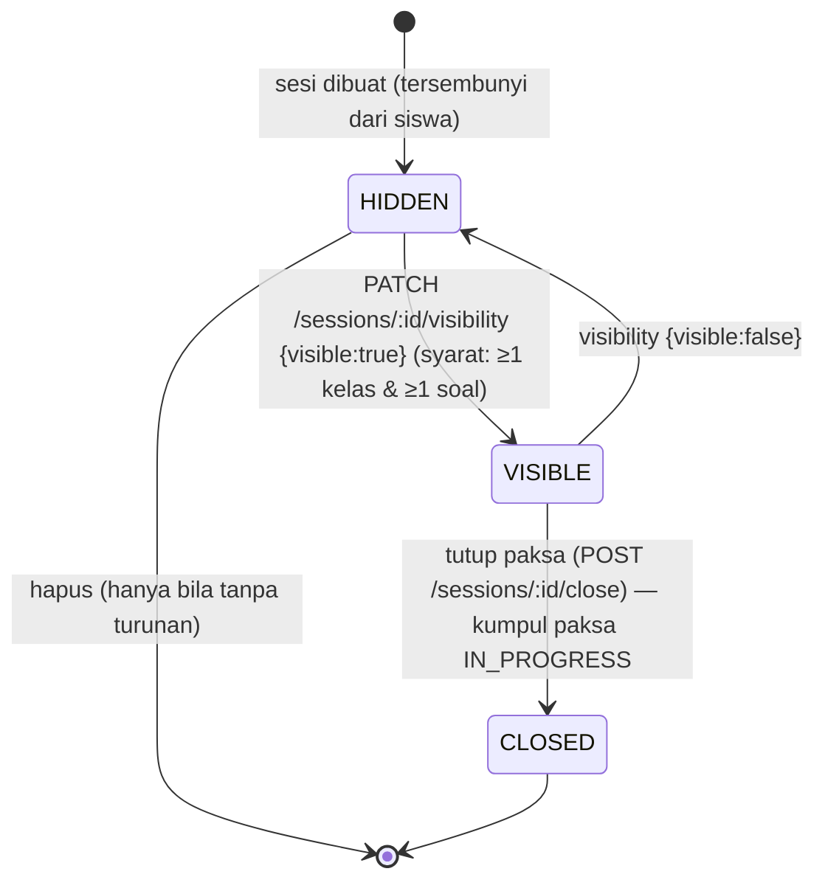

# PRD — CBT SMAN 1 Gorontalo

| Field | Nilai |
| --- | --- |
| Versi | 1.0 |
| Tanggal | 21 Oktober 2026 |
| Status | Living document (setelah audit E2E) |
| Audiens | Product owner, pengembang, operator sekolah, AI coding agent |
| Sumber kode | `apps/api`, `apps/web`, `packages/shared`, `apps/api/prisma/schema.prisma` |
| Dokumen terkait | [ERD](./ERD.md) · [API](./API.md) · [Deployment](./DEPLOYMENT.md) · [README](../README.md) |

Dokumen ini menjelaskan **apa** yang dibangun, **untuk siapa**, **aturan bisnisnya**, dan **batasan yang masih terbuka**. Detail teknis endpoint ada di `docs/API.md`; detail model data ada di `docs/ERD.md`.

---

## 1. Ringkasan produk

CBT SMAN 1 Gorontalo adalah aplikasi ujian berbasis komputer untuk sekolah menengah. Guru menyusun bank soal dan ujian, proktor mengelola pelaksanaan di ruang ujian, siswa mengerjakan ujian dengan token, lalu guru menilai dan menerbitkan hasil. Admin mengelola data master, akun, konfigurasi, dan audit.

Prinsip utama:

1. **Server adalah sumber kebenaran** untuk waktu ujian, token, jawaban, dan nilai.
2. **Satu akun = satu peran** (ADMIN, GURU, SISWA, PROKTOR) dengan pembatasan akses di API, bukan hanya di UI.
3. **Ujian harus tahan refresh/jaringan putus**: jawaban di-autosave, urutan soal stabil per attempt, timer dihitung server.
4. **Hasil tidak bocor sebelum diumumkan**: skor dan pembahasan hanya tampil setelah guru mem-publish.
5. **Semua aksi penting tercatat** di audit log (login tidak dicatat, aksi data ya).

---

## 2. Masalah yang diselesaikan

| Masalah | Solusi |
| --- | --- |
| Ujian kertas lambat diproses dan rawan kebocoran | Bank soal digital, token bergulir, penilaian otomatis |
| Peserta datang terlambat / ruang tidak siap | Checklist kesiapan lab, absensi digital, kartu peserta |
| Kecurangan dan gangguan saat ujian | Monitoring realtime, heartbeat, pencatatan pelanggaran, peringatan/perpanjangan/pengumpulan paksa |
| Guru butuh analisis butir soal | Analitik ujian + analisis kesulitan/daya pembeda/pengecoh |
| Hasil ujian harus resmi | Ekspor Excel nilai, jejak audit |

---

## 3. Peran dan hak akses

| Peran | Tujuan utama | Boleh | Tidak boleh |
| --- | --- | --- | --- |
| **ADMIN** | Operasional & data master | Semua modul; kelola pengguna/kelas/mapel/konfigurasi/audit; akses semua ujian & sesi | Menonaktifkan/mengubah role akun sendiri |
| **GURU** | Menyusun dan menilai | CRUD soal milik sendiri; CRUD ujian milik sendiri; sesi milik sendiri; nilai, review, publish, analitik ujian sendiri | Mengubah data guru lain; mengelola akun/kelas/mapel |
| **PROKTOR** | Pelaksanaan ruang ujian | Lihat semua sesi; token, absensi, kartu, ekspor, monitoring, kendali attempt, baca penilaian/hasil/analitik | Membuat/mengubah soal, ujian, sesi; publish hasil |
| **SISWA** | Mengerjakan ujian | Lihat sesi kelasnya; mulai attempt dengan token; autosave; submit | Melihat nilai/attempt/hasil siswa lain; mengakses bank soal |

Aturan tambahan:

- Siswa wajib punya `NISN` 10 digit dan `kelasId`; `username` siswa = `NISN`.
- Guru hanya dapat memakai soal miliknya di ujiannya; admin bebas.
- Kepemilikan sesi mengikuti kepemilikan ujian induk.
- Endpoint yang bukan milik pengguna mengembalikan **404** (bukan 403) untuk menyembunyikan keberadaan data.

---

## 4. Ruang lingkup

### 4.1 Termasuk

- Autentikasi JWT access + refresh rotation, ganti password.
- Manajemen pengguna (CRUD, import Excel, reset password, nonaktif).
- Kelas + tahun ajaran, mata pelajaran.
- Bank soal 5 tipe: PG, PG kompleks, matching, benar–salah, isian singkat; gambar soal; duplikasi.
- Ujian dan sesi ujian (jadwal, durasi, aturan, kelas peserta, status).
- Token 6 digit bergulir per sesi.
- Ruang ujian siswa: gate token, timer server, autosave, ragu-ragu, submit, resume, anti-cheat dasar.
- Verifikasi Safe Exam Browser (SEB) di server melalui request hash (Browser Exam Key).
- Absensi digital, checklist kesiapan, kartu peserta PDF, ekspor Excel.
- Monitoring realtime Socket.io + kendali per peserta.
- Penilaian otomatis 5 tipe, review manual isian singkat, publish/tarik hasil, analitik.
- ~~Sertifikat/BAU PDF dengan QR~~ — DIHAPUS 11 Nov 2026.
- Audit log dan konfigurasi global (penyimpanan).

### 4.2 Di luar lingkup (saat ini)

- Integrasi Dapodik/EMIS, sinkronisasi akun otomatis.
- ~~Verifikasi publik QR sertifikat~~ (dihapus 11 Nov 2026).
- Aplikasi mobile native; web responsif sudah tersedia.
- Pembayaran, penjadwalan otomatis multi-sekolah, multi-tenant.
- Analitik lintas ujian/sekolah dan dashboard longitudinal.

---

## 5. Alur kerja utama

### 5.1 Admin menyiapkan data

1. Login `POST /auth/login/admin`.
2. Buat kelas + tahun ajaran, mapel, akun guru/proktor/siswa (manual atau import Excel).
3. Atur konfigurasi global (catatan: beberapa nilai belum diterapkan — lihat §10).
4. Pantau audit log.

### 5.2 Guru menyusun ujian

1. Buat soal di bank soal (5 tipe, bobot, kunci, pembahasan, gambar opsional).
2. Buat ujian dan pilih mapel.
3. Susun soal ujian (`PUT /exams/:id/questions`) — urutan tersimpan; soal terkunci saat sesi tampil ke siswa.
4. Buat sesi: **hari pelaksanaan** (Hari 1–5 / Senin–Jumat), durasi, batas pelanggaran, wajib SEB, acak soal/opsi, kelas peserta (interval token diatur proktor di tab Token).
5. Tampilkan/sembunyikan ujian ke siswa — satu saklar `PATCH /sessions/:id/visibility` (tampil ⇒ `status='ACTIVE'`); alur DRAFT→SCHEDULED→ACTIVE→CLOSED tidak dipakai lagi.

### 5.3 Proktor melaksanakan ujian

1. Pilih sesi; (checklist lab dihapus — ready tidak lagi dipakai).
2. Catat absensi peserta (HADIR/TERLAMBAT/IZIN/SAKIT/ALPA; status "Belum" = belum dicatat).
3. Buat kartu peserta (satuan/semua) dan cetak PDF.
4. Tampilkan sesi ke siswa; **rilis token** di tab Token (atau lewat dialog saat menampilkan), umumkan ke peserta. Interval token diatur di tab Token.
5. Pantau papan monitoring: status, progres, pelanggaran, online.
6. Tindakan: peringatkan, perpanjang waktu, kumpulkan paksa, **Tutup & Kumpul Paksa** (tombol darurat di pengaturan pelaksanaan).
7. Setelah selesai: ekspor absensi/ringkasan.

### 5.4 Siswa mengerjakan ujian

1. Login dengan NISN.
2. Lihat sesi yang tampil ke siswa; tombol "Mulai (butuh token)".
3. Masukkan token 6 digit → server membuat attempt (sekali per sesi).
4. Kerjakan soal; jawaban di-autosave; timer berjalan di server.
5. Jika waktu habis → attempt EXPIRED otomatis dan dinilai.
6. Submit manual → attempt SUBMITTED dan dinilai.
7. Hasil baru tampil setelah guru publish.

### 5.5 Guru menilai dan mengumumkan

1. Buka sesi → tab penilaian; jalankan nilai ulang bila perlu.
2. Review jawaban isian singkat yang tidak cocok kunci (skor 0..bobot).
3. Publish hasil — ditolak bila masih ada attempt IN_PROGRESS atau review tertunda.
4. Analisis butir, ekspor nilai.

### 5.6 Model pelaksanaan (15 Nov 2026)

**Sesi**



**Attempt**

```mermaid
stateDiagram-v2
  [*] --> IN_PROGRESS: start + token valid
  IN_PROGRESS --> SUBMITTED: submit manual
  IN_PROGRESS --> EXPIRED: expiresAt lewat
  IN_PROGRESS --> FORCE_SUBMITTED: proktor / maxViolations / tutup paksa
  IN_PROGRESS --> LOCKED: batas pelanggaran (buka dgn token proktor; hitungan reset ke 0)
  LOCKED --> IN_PROGRESS: unlock (POST /attempts/:id/unlock)
  SUBMITTED --> [*]
  EXPIRED --> [*]
  FORCE_SUBMITTED --> [*]
```



---

## 6. Kebutuhan fungsional

Kode ID dipakai untuk referensi silang di test/issue.

### 6.1 Autentikasi & akun

| ID | Kebutuhan | Kriteria terima |
| --- | --- | --- |
| FR-AUTH-01 | Login per role | `POST /auth/login/:role`; password salah & role salah → 401 dengan pesan generik |
| FR-AUTH-02 | Access + refresh token | Access default 15 menit; refresh default 7 hari; refresh sekali pakai (rotasi) |
| FR-AUTH-03 | Logout & revoke | Logout mencabut refresh; ganti/reset password mencabut semua refresh user |
| FR-AUTH-04 | Ganti password | Wajib password lama; password baru 6–72 karakter; tidak boleh sama |
| FR-AUTH-05 | Akun nonaktif | Tidak bisa login/refresh; attempt & data tetap tersimpan |
| FR-AUTH-06 | Proteksi brute force token | Salah token per user/sesi maks 10 kali/5 menit → 429 |
| FR-AUTH-07 | Throttle login | Maks 5 gagal per IP+username per 5 menit → 429; login sukses mereset counter |

### 6.2 Admin

| ID | Kebutuhan | Kriteria terima |
| --- | --- | --- |
| FR-ADM-01 | CRUD pengguna | Filter role/kelas/status/cari; password di-hash; username tidak bisa diubah |
| FR-ADM-02 | Import Excel | Header `Username/Password/Nama/Role/NISN/Kelas`; per baris independen; laporan sukses/gagal; validasi sama dengan create |
| FR-ADM-03 | Reset password | Admin set password baru; semua sesi user dicabut |
| FR-ADM-04 | Data master | CRUD kelas (unik per nama + tahun ajaran), mapel (nama/kode unik) |
| FR-ADM-05 | Konfigurasi | Key dibatasi `CONFIG_KEYS`; nilai divalidasi; perubahan masuk audit |
| FR-ADM-06 | Audit log | Paginasi + filter action/entity/actor |

### 6.3 Guru — bank soal & ujian

| ID | Kebutuhan | Kriteria terima |
| --- | --- | --- |
| FR-GURU-01 | 5 tipe soal | Validasi kunci per tipe; ID opsi/pasangan/pernyataan unik |
| FR-GURU-02 | Gambar soal | Upload ≤5 MB; ekstensi & isi byte gambar; URL publik `/uploads/...`; hapus file saat tak dipakai |
| FR-GURU-03 | Duplikasi & hapus | Duplikat menyalin kunci; hapus ditolak bila soal dipakai ujian/jawaban |
| FR-GURU-04 | Susun ujian | Minimal 1 soal, maks 200, tanpa duplikat; urutan tersimpan; terkunci saat sesi tampil ke siswa |
| FR-GURU-05 | Sesi | Durasi 5–480 menit; interval token 30–600 detik; maxViolations 0–20; jadwal valid |
| FR-GURU-06 | Visibilitas sesi | Toggle isibleToSiswa; syarat ≥1 kelas & ≥1 soal dicek server |

### 6.4 Proktor

| ID | Kebutuhan | Kriteria terima |
| --- | --- | --- |
| FR-PROK-01 | Token | Token 6 digit berubah tiap interval; rilis dicatat (nilai token, waktu, aktor); hanya sesi yang tampil ke siswa |
| FR-PROK-02 | Absensi | Satu baris per peserta; status enum; catatan opsional; note lama tidak terhapus bila tidak dikirim |
| FR-PROK-03 | Kesiapan | Checklist item bebas (1–30), `isComplete` bila semua checked; tersimpan per sesi |
| FR-PROK-04 | Kartu | Serial unik & stabil; generate satuan/semua idempoten; PDF terautentikasi; ekspor Excel |
| FR-PROK-05 | Monitoring | Papan per sesi: attempt, progres, violation, online (`heartbeat` TTL 90 detik), sisa waktu |
| FR-PROK-06 | Kendali | Peringatan (tercatat integritas OTHER), perpanjangan ≤120 menit & tidak melewati `endsAt`, force-submit + penilaian |
| FR-PROK-07 | Ekspor | Absensi (XLSX/PDF), nilai, ringkasan; sesi tidak dikenal → 404 |

### 6.5 Siswa — ruang ujian

| ID | Kebutuhan | Kriteria terima |
| --- | --- | --- |
| FR-SISWA-01 | Daftar sesi | Hanya sesi kelasnya yang tampil; sertakan attempt sendiri; badge TERKUNCI bila terkunci |
| FR-SISWA-02 | Gate masuk | Sesi tampil ke siswa, kelas cocok, token valid, dan request-hash SEB valid bila diwajibkan |
| FR-SISWA-03 | Satu attempt | `@@unique(sessionId,userId)`; start ganda mengembalikan attempt yang sama, bukan 500 |
| FR-SISWA-04 | Timer | `expiresAt = min(start + durasi, endsAt)`; refresh tidak menambah waktu; extend proktor mengubah `expiresAt` |
| FR-SISWA-05 | Autosave | Satu jawaban per request; validasi payload per tipe; DB sumber utama, Redis cadangan; flag ragu-ragu |
| FR-SISWA-06 | Resume | Urutan soal & opsi stabil per attempt (seed attempt+question); jawaban tersimpan dikembalikan |
| FR-SISWA-07 | Integritas | Tab switch, fullscreen exit, blur, copy/paste, context menu, devtools, SEB missing, OTHER; melewati batas → force submit |
| FR-SISWA-08 | Hasil | Hanya attempt sendiri & setelah publish; skor/pembahasan/kunci tidak bocor sebelum publish |

### 6.6 Penilaian & pelaporan

| ID | Kebutuhan | Kriteria terima |
| --- | --- | --- |
| FR-NILAI-01 | Skor otomatis | PG all-or-nothing; PG kompleks/matching/benar-salah all-or-nothing atau proporsional; isian cocok kunci (case-insensitive, angka) |
| FR-NILAI-02 | Review manual | Isian singkat tak cocok kunci masuk daftar review; skor 0..bobot; override guru menang |
| FR-NILAI-03 | Nilai ulang | Idempoten; attempt selesai dinilai ulang |
| FR-NILAI-04 | Publish | Tanpa attempt IN_PROGRESS; tanpa review tertunda; bisa ditarik; publish = pengumuman saja — nilai TIDAK tampil ke siswa di app (11 Nov 2026) |
| FR-NILAI-05 | Analitik | Statistik sesi, distribusi nilai, analisis butir (kesulitan, daya pembeda 27%, pengecoh) |
| FR-NILAI-06 | ~~Sertifikat~~ DIHAPUS 11 Nov 2026 | Fitur BA Digital/sertifikat PDF dihapus sepenuhnya (UI, endpoint, verifikasi QR publik) |

---

## 7. Aturan bisnis rinci

### 7.1 Token ujian

- Algoritma: HMAC-SHA1 TOTP-like, 6 digit, counter `floor(now / interval)`.
- Secret acak per sesi; interval default 120 detik (30–600).
- Verifikasi toleran ±1 interval.
- Token hanya untuk sesi yang tampil ke siswa; rilis dicatat di TokenAudit.
- Salah token dihitung per `(sesi, user)` di Redis; 10 kegagalan → 429 selama ±5 menit (fail-open bila Redis mati).
- Token bukan pengganti autentikasi: siswa tetap harus login dan terdaftar di kelas sesi.

### 7.2 Waktu & attempt

- Server menghitung `expiresAt` saat start; klien hanya menampilkan.
- Attempt kedaluwarsa ditandai `EXPIRED`, `submittedAt` diisi, dan langsung dinilai saat state/save/submit berikutnya.
- Perpanjangan proktor menambah dari `max(expiresAt, now)` dan dibatasi `session.endsAt`.
- Sesi tersembunyi memblokir start; tutup paksa (POST /sessions/:id/close) menghentikan semua attempt berjalan + menilai otomatis.

### 7.3 Jawaban & penilaian

- Payload per tipe: PG string|null; PG kompleks string[]; benar–salah `Record<id,boolean>`; matching `Record<leftId,rightId>`; isian string.
- PG kompleks proporsional: `max(0, (hits - wrong) / totalKey)` agar menebak tidak untung.
- Isian singkat: normalisasi trim/lowercase/rapat spasi; angka `0,5` = `0.5`; multi-kunci.
- Skor butir = `ratio × bobot`; skor akhir attempt = jumlah skor butir; override review menggantikan skor otomatis.
- Pembulatan 2 desimal.

### 7.4 Pelanggaran

- Setiap laporan integritas menambah `violationCount` dan menyimpan `IntegrityLog`.
- Bila `maxViolations > 0` dan tercapai: attempt `FORCE_SUBMITTED`, dinilai, dan proktor melihat di papan.
- Peringatan proktor juga dicatat sebagai integritas `OTHER`.

### 7.5 Absensi & kartu

- Absensi hanya untuk peserta aktif (siswa aktif di kelas sesi).
- Status valid: HADIR, TERLAMBAT, IZIN, SAKIT, ALPA. "Belum" berarti belum ada baris.
- Simpan massal hanya mengubah baris yang dikirim; `note` tidak dikirim = note lama dipertahankan.
- Serial kartu: `K-<sesi8>|<kelas8>|<urutan3>-<tahunAjaran>`; jika urutan roster berubah dan serial bentrok, server mengalokasikan nomor bebas berikutnya (tidak pernah mengembalikan kartu milik siswa lain).
- Kartu hanya untuk siswa yang terdaftar di kelas peserta sesi.

### 7.6 Publikasi hasil

- Publish butuh: semua peserta selesai; tidak ada review tertunda.
- Unpublish kapan saja oleh guru/admin.
- (Dihapus 11 Nov 2026) ~~Siswa melihat skor di `GET /attempts/:id/result` dan di daftar sesi hanya setelah publish~~ — nilai TIDAK PERNAH tampil di aplikasi; guru membagikan nilai lewat ekspor Excel setelah semua isian singkat dinilai (tombol "Unduh nilai (Excel)" di halaman penilaian, terkunci selama `pendingReview > 0`).

### 7.7 Keamanan akses

- Login: maks. 5 gagal per `(IP, username)` per 5 menit; sukses mereset counter. Redis mati = throttle fail-open agar login tetap tersedia.
- SEB: sesi `requireSeb` hanya menerima request dengan `X-SafeExamBrowser-RequestHash` valid = `SHA256(URL absolut + Browser Exam Key)`.
- Verifikasi SEB berlaku di start, state, autosave, submit, dan integritas — bukan hanya di start.
- `SEB_BROWSER_EXAM_KEY` wajib diisi di server; bila kosong, sesi wajib SEB gagal `503` (fail-closed).
- Field `seb` dari klien hanya advisory dan tidak boleh dipercaya.

---

## 8. Non-functional requirements

| Aspek | Ketentuan |
| --- | --- |
| Keamanan | JWT access pendek + refresh rotasi; password bcrypt; throttle login per IP+username; verifikasi request-hash SEB; helmet; CORS terbatas; validasi Zod; upload cek ekstensi + magic bytes + traversal; otorisasi per resource; audit trail |
| Ketersediaan | Redis untuk autosave/heartbeat/throttle; Redis mati tidak boleh memblokir autosave atau login (throttle fail-open); refresh fail-closed; sesi wajib SEB fail-closed bila key server belum diset |
| Performa | Paginasi list (max 100); board monitoring melakukan query per attempt heartbeat; target praktis ≤200 peserta/sesi |
| Skalabilitas | Satu instance API + Socket.io saat ini; multi-instance memerlukan adapter Redis untuk Socket.io |
| Observabilitas | Log Nest, health check DB+Redis, audit log aplikasi |
| Klien | Web responsif, tema terang/gelap, bahasa Indonesia |
| Operasional | Docker Compose (Postgres, Redis, API, nginx+web); migrasi & seed otomatis saat start API |
| Batas upload | Gambar soal 5 MB; import Excel 5 MB / 2000 baris |
| Zona waktu | Tanggal disimpan UTC; tampilan `id-ID` di server untuk ekspor |

---

## 9. Data & privasi

- Data pribadi: nama, NISN, username, kelas, hasil ujian, IP/user-agent attempt, catatan integritas.
- Password tidak pernah dikembalikan API (`SAFE_SELECT`).
- Siswa tidak bisa melihat data siswa lain; guru melihat peserta ujiannya; proktor melihat peserta sesi.
- Audit log menyimpan aktor, aksi, entity, metadata perubahan (tanpa password).
- Retensi data belum diotomatiskan; penghapusan user/kelas/sesi mengikuti relasi cascade (hati-hati: hapus user menghapus attempt/kartu/absensi).

---

## 10. Batasan yang masih terbuka (hasil audit 21 Okt 2026)

### 10.1 Sudah diperbaiki pada audit ini

| Bug | Dampak | Perbaikan |
| --- | --- | --- |
| Panel absensi mengirim status `BELUM` | Seluruh simpan absensi 400 bila ada peserta belum ditandai | UI hanya mengirim status valid; baris "Belum" dilewati; pesan jumlah tersimpan |
| Kartu peserta bisa mengembalikan kartu siswa lain | Serial bentrok saat roster berubah; kartu salah orang | Alokasi serial bebas berikutnya; hanya menerima baris milik user yang sama |
| Import Excel melewati validasi username/nama/password | Data kotor masuk (spasi, `!`, nama >100, password >72) | Validasi baris memakai `userImportRowSchema` yang sama |
| Start attempt ganda → 500 | Double-click/retry siswa mendapat error server | P2002 ditangkap; kedua request mengembalikan attempt yang sama |
| Generate kartu tanpa `userId` menargetkan aktor | Proktor/admin dapat 404 membingungkan | `userId` wajib (400) |
| Ekspor kartu sesi tidak dikenal | File kosong, bukan 404 | Cek sesi → 404 |
| Indikator online monitoring basi | Peserta diam online tampak offline | Polling papan 15 detik (heartbeat tetap 25 detik) |
| Pesan validasi Zod sangat panjang | 400 berisi puluhan error berulang | Maksimal 5 error + ringkasan sisa |
| Login tanpa throttle | Brute force password tak dibatasi | 5 gagal per IP+username/5 menit → 429; counter di Redis; reset saat login sukses |
| SEB hanya laporan klien (`seb: true`) | Siswa bisa mengaku memakai SEB | Server memverifikasi `X-SafeExamBrowser-RequestHash` (SHA256 URL + Browser Exam Key) pada start/state/autosave/submit/integritas; `seb` klien hanya advisory |

### 10.2 Celah / keputusan yang belum dikerjakan

| Prioritas | Celah | Rekomendasi |
| --- | --- | --- |
| ~~P1~~ | ~~QR sertifikat hanya teks~~ | Tertutup dengan menghapus fitur BA Digital (11 Nov 2026) |
| P2 | ~~Readiness tidak menjadi syarat ACTIVE~~ | Dihapus dari aplikasi (15 Nov 2026) |
| P2 | ~~Tutup sesi tidak menghentikan attempt~~ | Terimplementasi (tombol Darurat: POST /sessions/:id/close) |
| P2 | Konfigurasi global belum dipakai | Terapkan default sesi (token, maxViolations, SEB), branding, tahun ajaran, KKM |
| P2 | KKM belum dipakai | Tampilkan lulus/tidak di hasil & ekspor |
| P3 | Builder ujian tidak bisa mengosongkan soal (min 1) | Longgarkan validasi atau sediakan "arsipkan semua soal" |
| P3 | Panel absensi belum bisa mengisi catatan | Tambah input note per peserta |
| P3 | Daftar sesi proktor tanpa paginasi/pencarian di UI | Tambah kontrol limit/search |
| P3 | Monitoring polling 15 detik | Broadcast event heartbeat/presence bertahap (throttle) |
| P3 | Pesan error import sebagian Inggris | Tambahkan pesan Indonesia pada schema import |

---

## 11. Pertanyaan keputusan untuk pemilik produk

1. **SEB** *(diputuskan 13 Nov 2026 — klien Android)*: sekolah memakai **APK SEB Android kustom** (`docs/SEB-ANDROID.md`, sideload, BYOD); Browser Exam Key dikelola **sekolah** (operator memegang key; dibagikan ke server `.env` dan diisi operator di tiap perangkat via mode tersembunyi, tersimpan terenkripsi). Satu key per sekolah default (per sesi/per lab tetap mungkin lewat multi-key `.env`); key bisa dirotasi kapan pun (transisi memakai multi-key). File `.seb` untuk SEB desktop Windows tidak wajib selama lab memakai APK Android.
2. ~~**QR sertifikat**~~ — fitur BA Digital/sertifikat dihapus 11 Nov 2026.
3. **Readiness** — sudah DIHAPUS (15 Nov 2026); tidak perlu dijawab.
4. **Tutup sesi** — terimplementasi sebagai tombol Darurat (POST /sessions/:id/close): semua attempt IN_PROGRESS otomatis dikumpulkan & dinilai.
5. **Konfigurasi global**: nilai mana yang wajib langsung diterapkan (default token, maxViolations, wajib SEB, KKM, branding, tahun ajaran)?
6. **KKM**: berapa default dan apakah dipakai untuk status kelulusan di hasil/ekspor?
7. **Absensi**: default "Belum" dipertahankan, atau sediakan tombol "tandai semua HADIR"?
8. **Builder ujian**: boleh menyimpan ujian tanpa soal (draft), atau tetap minimal 1 soal?
9. ~~**Sertifikat**~~ — fitur dihapus 11 Nov 2026.
10. **Rate limit login**: default saat ini 5 gagal per IP+username/5 menit — apakah ambang ini cocok untuk lab sekolah dengan banyak salah ketik?

---

## 12. Kriteria penerimaan rilis

Rilis dianggap sehat bila:

1. `npm run build -w @cbt/api` dan `npm run build -w @cbt/web` lulus.
2. Seluruh suite verifikasi lulus: 422 cek (lihat tabel di bawah).
3. Tidak ada regresi pada alur inti: login 4 role → guru membuat soal/ujian/sesi → proktor token/absensi/kartu → siswa start/autosave/submit → guru nilai/review → ekspor nilai Excel (setelah review tuntas) → publish (pengumuman tanpa angka).
4. Bug P1 di §10.2 sudah diputuskan (diperbaiki atau diterima sebagai risiko).
5. Backup database & rotasi password seed dilakukan sebelum produksi.

| Suite | Cakupan | Jumlah |
| --- | --- | --- |
| `scripts/verify-roles.mjs` | Matriks akses role + kebersihan data uji | 172 |
| `scripts/verify-audit.mjs` | Bug audit lama (upload, kartu, grading, dll.) | 46 |
| `scripts/verify-audit2.mjs` | Regresi audit-2 + E2E ujian penuh + web | 34 |
| `scripts/verify-hardening.mjs` | Refresh rotation, throttle login/token, upload, SEB | 25 |
| `scripts/verify-fase-4-5.mjs` | Proktor + ruang ujian siswa | 40 |
| `scripts/verify-fase-6.mjs` | Monitoring realtime + kendali | 29 |
| `scripts/verify-fase-7.mjs` | Penilaian, review, publish, analitik | 76 |
| **Total** | | **422** |

Cara menjalankan (dev API):

```bash
CBT_BASE=http://localhost:3000/api CBT_ORIGIN=http://localhost:3000 \
  node scripts/verify-audit.mjs
# verify-audit2 memeriksa web container:
CBT_BASE=http://localhost:3000/api CBT_ORIGIN=http://localhost:8080 \
  node scripts/verify-audit2.mjs
# verify-roles menguji SEB; samakan dengan key server bila berbeda:
CBT_BASE=http://localhost:3000/api CBT_ORIGIN=http://localhost:3000 \
  CBT_SEB_KEY="$SEB_BROWSER_EXAM_KEY" node scripts/verify-roles.mjs
```

---

## 13. Glosarium

| Istilah | Arti |
| --- | --- |
| Attempt | Satu kesempatan siswa mengerjakan satu sesi |
| Bank soal | Kumpulan soal milik guru |
| Sesi | Pelaksanaan ujian untuk kelas tertentu pada jadwal tertentu |
| Token | Kode 6 digit bergulir untuk membuka attempt |
| Publish | Menerbitkan hasil (pengumuman saja — nilai tidak tampil di aplikasi siswa) |
| Heartbeat | Sinyal berkala siswa agar status online di papan monitoring |
| Force-submit | Mengumpulkan attempt siswa secara paksa |

Referensi kode utama: `apps/api/prisma/schema.prisma`, `packages/shared/src/{enums,schemas}.ts`, `apps/api/src/**`, `apps/web/src/**`.
